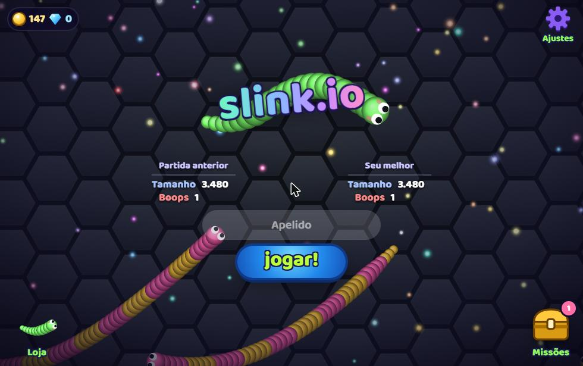

<div align="center">


<a href="https://slink-io.vercel.app">
  
</a>


<br/><br/>

<a href="https://slink-io.vercel.app">
  
</a>

</div>

<br/>

## ◆ Overview

Slink.io is a casual arcade game that runs entirely in the browser. Grow your slink, outplay the others in an animated arena and climb through a progression system with coins, gems, a shop and missions.

The whole game ships as a single static page. No install, no build step and no server, just open it and play.

<br/>

## ◆ Play

**Online.** Play the [live version](https://slink-io.vercel.app), hosted on Vercel.

**Locally.** Clone the repository and open `index.html` in any modern browser.

```bash
git clone https://github.com/Samuelpedroso-dev/slink-io.git
cd slink-io
```

<br/>

## ◆ Project Structure

```
slink-io/
├── index.html    game, styles and scripts
├── preview.jpg   screenshot used in this README
├── README.md     documentation
├── .gitignore
└── .nojekyll
```

<br/>

## ◆ Roadmap

<table>
<tr><td>◆</td><td>Release on web game portals such as CrazyGames and Poki</td></tr>
<tr><td>◆</td><td>New arenas and progression content</td></tr>
<tr><td>◆</td><td>Online leaderboards</td></tr>
</table>

<br/>

## ◆ Author

Built by **[Samuel Pedroso](https://github.com/Samuelpedroso-dev)**, Brazil.

If you enjoyed the game, consider leaving a ⭐ on the repository.

<div align="center">


</div>
